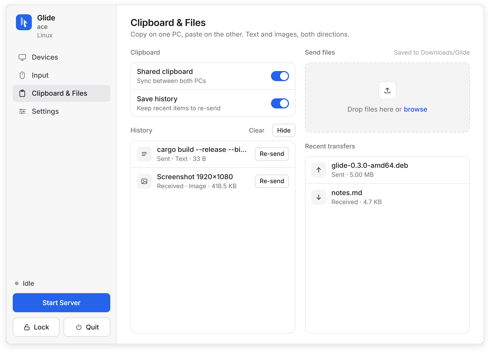
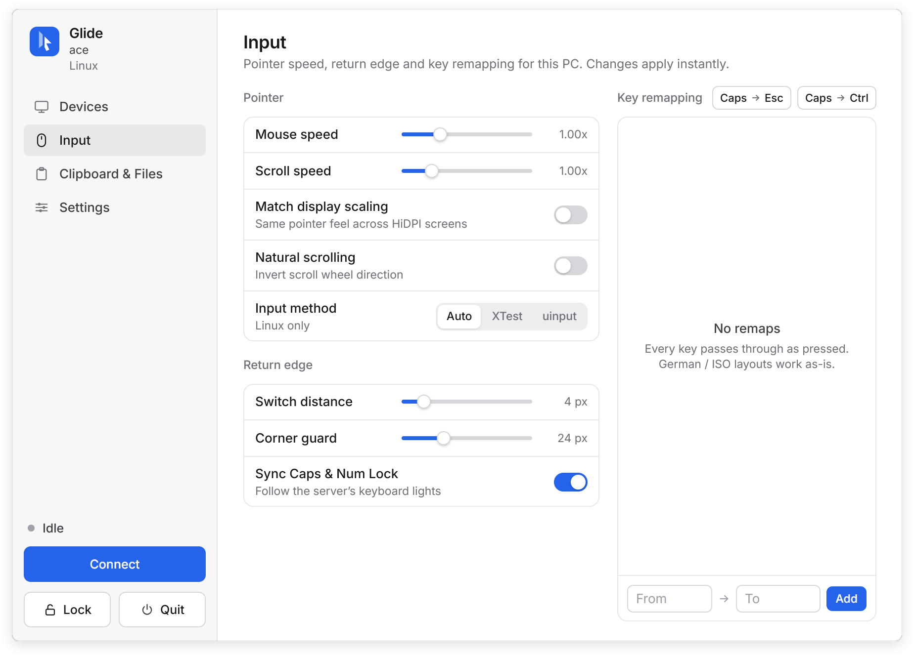

<div align="center">

<picture>
  <source media="(prefers-color-scheme: dark)" srcset="assets/readme/glide-logo-dark.svg">
  <source media="(prefers-color-scheme: light)" srcset="assets/readme/glide-logo-light.svg">
  
</picture>

### One mouse and keyboard across all your PCs.

Move your cursor off the edge of one screen and straight onto the next.<br>
Share your clipboard, paste screenshots, and drop files across your desk — directly over your local network.

**No account. No cloud. No internet required.**

<p>
  <a href="https://github.com/4our4ace/glide/releases"></a>
  
  
</p>

<br>

<picture>
  <source media="(prefers-color-scheme: dark)" srcset="assets/readme/devices-dark.png">
  <source media="(prefers-color-scheme: light)" srcset="assets/readme/devices-light.png">
  
</picture>

</div>

---

## Why Glide?

**Glide** is a fast, native software KVM for Windows and Linux. Put two computers next to each other, open Glide on both, and they feel like one seamless multi-monitor workstation.

- **Effortless screen switching** — Drag your PCs into place on the visual screen map and slide your mouse naturally from monitor to monitor. Your cursor hides cleanly on the idle PC so no ghost pointer lingers at the edge.
- **Built for real desks & gaming** — A gentle corner guard keeps you from slipping onto another PC when clicking a close button or taskbar, and fullscreen games automatically lock your cursor in place.
- **Shared clipboard, including screenshots** — Copy text, code, or screenshots (`Win+Shift+S`, Snipping Tool, browsers, Flameshot) on one PC and paste straight onto the other. Includes a quick clipboard history with one-click re-send and a privacy **Hide** cover whenever you want it.
- **Built-in file drop** — Drag any file onto Glide to send it straight to your other PC's `Downloads/Glide` folder at full local network speed — no USB drives, no cloud uploads, no extra apps.
- **Zero setup, private by default** — Glide automatically discovers your other PCs on the same Wi-Fi or Ethernet network and encrypts everything directly between them. It remembers your last role (Server or Client) and reconnects automatically next time you launch it.
- **Truly native & lightweight** — One clean native app with no browser engine, no Electron bloat, and zero runtime DLLs to install on Windows.
- **International keyboard friendly** — German and European ISO layouts (`ä ö ü ß`, `AltGr`, `< > |`, dead keys) work cleanly out of the box, alongside synced Caps Lock / Num Lock keyboard lights.

---

## Shared Clipboard & Instant File Drop

Copy on Windows, paste on Linux — or the other way around. Need to move a build, log, or screenshot over? Just drop it straight into the window and it lands in `Downloads/Glide` on the other machine.

<div align="center">
  
</div>

---

## Tuned to Each Machine

Different monitor sizes, mice, or keyboard habits? Adjust pointer speed, scroll speed, natural scrolling, corner guard, and custom key remaps (like `Caps Lock → Escape`) per PC — every change takes effect immediately.

<div align="center">
  <picture>
    <source media="(prefers-color-scheme: dark)" srcset="assets/readme/input-dark.png">
    <source media="(prefers-color-scheme: light)" srcset="assets/readme/input-light.png">
    
  </picture>
</div>

---

## Getting Started

Grab the latest build from [Releases](https://github.com/4our4ace/glide/releases) (or [build from source](#building-from-source)).

### Windows 11

Download and double-click **`glide-windows-x86_64.exe`**.

> [!NOTE]
> Glide is completely standalone on Windows — no installer, no Visual C++ Redistributable, and no extra DLLs required.

1. Click **Start Server** on the PC with your mouse and keyboard.
2. If Windows Firewall pops up, allow access on **Private networks**.

### Ubuntu / Debian Linux (X11)

Install the `.deb` package:

```bash
sudo apt install ./glide_0.3.0_amd64.deb
```

1. Open **Glide** from your application launcher (or run `glide`).
2. Switch to **Client** — your Windows PC appears automatically under **Nearby servers**.
3. Drag **This PC** to the side it sits on and click **Connect**.

> [!TIP]
> After your first connection, Glide remembers each PC's role and connects automatically whenever you open it.

---

## Keyboard Shortcuts

| Shortcut | Action |
| --- | --- |
| `Ctrl + Alt + Arrow` | Jump directly to the PC on that side |
| `Ctrl + Alt + L` | Lock or unlock the cursor to the current screen |
| `Scroll Lock` | Emergency escape — bring your cursor straight back home |

---

## FAQ

### Does Glide need an account or internet connection?
No. Glide talks directly between your PCs over your local network (Wi-Fi or Ethernet) with end-to-end encryption enabled automatically.

### Does copying screenshots work between Windows and Linux?
Yes. Screenshots from Windows `Win+Shift+S`, Snipping Tool, Paint, browsers, and Linux tools like Flameshot convert and paste cleanly in both directions.

### Will my mouse accidentally leave a fullscreen game?
No. Glide automatically detects fullscreen windows and locks your cursor to the current screen. You can also toggle manual lock anytime with `Ctrl + Alt + L` or the **Lock** button.

### Does the live latency graph add any lag?
Not at all. It only reads the connection's built-in timing locally and never sends extra ping traffic.

### Which operating systems are supported?
Currently **Windows 11** and **Linux (X11)** (tested on Ubuntu 22.04+).

---

## For Power Users & Developers

<details>
<summary><strong>CLI / Headless Mode</strong></summary>

<br>

Glide also runs cleanly from the terminal or as a background service:

```powershell
# Windows primary (server)
.\glide-windows-x86_64.exe server
```

```bash
# Linux client (auto-discovers the server on your LAN)
glide client --edge right

# Optional Linux /dev/uinput backend for native libinput acceleration & hi-res scroll
glide client --edge right --backend uinput

# LAN discovery & system check
glide discover
glide doctor
```

</details>

<details>
<summary><strong>Building From Source</strong></summary>

<br>

Requires Rust (stable, 1.80+).

- **Linux:** `./scripts/build-linux.sh` (or `./scripts/build-deb.sh` to build the `.deb` package)
- **Windows:** `.\scripts\build-windows.ps1`
- **Tests:** `cargo test --workspace`

</details>

<details>
<summary><strong>Under the Hood</strong></summary>

<br>

Glide is written in Rust with a GPU-rendered native UI (`wgpu` / `winit` via Rune) and a 3-lane QUIC + TLS 1.3 transport:

- **Unreliable QUIC datagrams** for raw relative mouse deltas and high-resolution scroll (zero TCP head-of-line blocking)
- **Reliable ordered control stream** for physical USB HID scancodes, clicks, lock-key sync, and screen transitions
- **Independent bulk streams** for clipboard sync and SHA-256 verified file transfers

For full protocol and design details, see [`ARCHITECTURE.md`](ARCHITECTURE.md) and [`TO-DO.md`](TO-DO.md).

</details>

---

## License

Dual-licensed under **MIT** or **Apache-2.0**.
