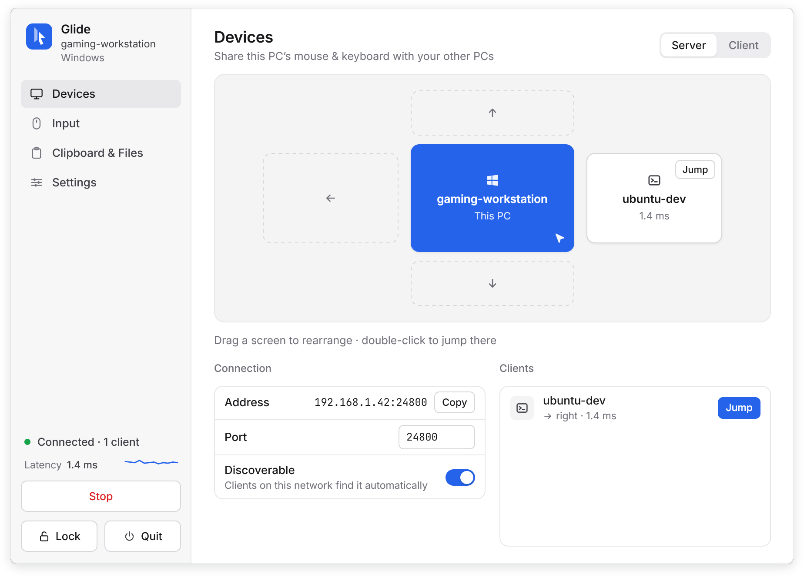

<div align="center">

<picture>
  <source media="(prefers-color-scheme: dark)" srcset="assets/readme/glide-logo-dark.svg">
  <source media="(prefers-color-scheme: light)" srcset="assets/readme/glide-logo-light.svg">
  
</picture>

### One mouse and keyboard across all your PCs.

Move your cursor off the edge of one screen and straight onto the next.<br>
Share your clipboard, paste screenshots, and drag files straight across screen edges — directly over your local network.

**No account. No cloud. No internet required.**

<p>
  <a href="https://github.com/4our4ace/glide/releases"></a>
  
  
</p>

<br>

<picture>
  <source media="(prefers-color-scheme: dark)" srcset="assets/readme/devices-dark.png">
  <source media="(prefers-color-scheme: light)" srcset="assets/readme/devices-light.png">
  
</picture>

</div>

---

## Why Glide?

**Glide** is a fast, native software KVM for Windows and Linux. Put two computers next to each other, open Glide on both, and they feel like one seamless multi-monitor workstation.

- **Effortless screen switching** — Drag your PCs into place on the visual screen map and slide your mouse naturally from monitor to monitor. Your cursor hides cleanly on the idle PC so no ghost pointer lingers at the edge.
- **Drag files straight across screen edges** — Grab a file on Windows, pull it past the edge onto Linux, and drop it straight into an open window (or drop large files into Glide's window). If an app blocks external drops, Glide saves the file to your receive folder, puts it on your clipboard for `Ctrl+V`, and shows a subtle hint next to your cursor.
- **Built for real desks & gaming** — A gentle corner guard keeps you from slipping onto another PC near close buttons or taskbars, fullscreen games auto-lock your cursor, and volume/media keys stay pinned to your main PC by default.
- **Private shared clipboard & screenshots** — Copy text, code, or screenshots (`Win+Shift+S`, Snipping Tool, browsers, Flameshot) and paste straight onto the other PC. Password-manager secrets (1Password, Bitwarden, KeePassXC) are automatically skipped, and clipboard history has a one-click **Hide** privacy cover.
- **Zero setup & resilient** — Automatically discovers PCs on your local network with end-to-end TLS 1.3 encryption, remembers saved server profiles for one-click switching, and recovers automatically from sleep/wake, monitor hotplugs, and Wi-Fi ↔ Ethernet changes.
- **Truly native & whisper-quiet** — Pure-Rust GPU-rendered app with zero Electron bloat, zero Windows runtime DLLs, and zero background redraws or idle LAN scans when tucked in the system tray.
- **International keyboard friendly** — German and European ISO layouts (`ä ö ü ß`, `AltGr`, `< > |`, dead keys) work cleanly out of the box, alongside synced Caps Lock / Num Lock keyboard lights.

---

## Shared Clipboard & Cross-Edge File Drop

Copy on Windows, paste on Linux — or pull a file straight off one screen and drop it onto the other. Choose a custom save folder, adjust the max file size limit (up to 4 GB) in Settings, and open received files or their folder in one click.

<div align="center">
  
</div>

---

## Tuned to Each Machine

Different monitor sizes, mice, or keyboard habits? Adjust pointer speed, scroll speed, natural scrolling, corner guard, media-key pinning, and custom key remaps (like `Caps Lock → Escape`) per PC — every change takes effect immediately.

<div align="center">
  <picture>
    <source media="(prefers-color-scheme: dark)" srcset="assets/readme/input-dark.png">
    <source media="(prefers-color-scheme: light)" srcset="assets/readme/input-light.png">
    
  </picture>
</div>

---

## Getting Started

Grab the latest build from [Releases](https://github.com/4our4ace/glide/releases) (or [build from source](#building-from-source)).

### Windows 11

Download and run **`glide-windows-x86_64-installer.msi`** *(recommended — per-user install with Start Menu shortcut, clean Apps & Features uninstaller, and no admin prompt)*, or run **`glide-windows-x86_64-standalone.exe`** directly without installing.

> [!NOTE]
> Glide has zero runtime dependencies on Windows — no Visual C++ Redistributable and no extra DLLs required.

1. Click **Start Server** on the PC with your mouse and keyboard.
2. If Windows Firewall pops up, allow access on **Private networks**.

### Ubuntu / Debian Linux (X11 & Wayland)

Install the `.deb` package:

```bash
sudo apt install ./glide_0.3.0_amd64.deb
```

1. Open **Glide** from your application launcher (or run `glide`).
2. Switch to **Client** — your Windows PC appears automatically under **Nearby servers**.
3. Drag **This PC** to the side it sits on and click **Connect**.

> [!TIP]
> On **Wayland** (Ubuntu 24.04 GNOME, KDE Plasma 6, Hyprland, Sway), Glide automatically uses the standard desktop portals and remembers your permission after the first prompt. After your first connection, Glide remembers each PC's role and connects automatically whenever you open it.

---

## Keyboard Shortcuts

| Shortcut | Action |
| --- | --- |
| `Ctrl + Alt + Arrow` | Jump directly to the PC on that side |
| `Ctrl + Alt + L` | Lock or unlock the cursor to the current screen |
| `Scroll Lock` | Emergency escape — bring your cursor straight back home |

---

## FAQ

### Does Glide need an account or internet connection?
No. Glide talks directly between your PCs over your local network (Wi-Fi or Ethernet) with end-to-end encryption enabled automatically. On the default **Stable** channel, Glide never connects to the internet unless you click **Check** in *Settings → Updates*. You can also opt into the **Nightly** channel in Settings to test the latest dev builds with SHA-256 verified one-click **Update & Restart** (and switch back to **Stable** anytime).

### Does copying screenshots work between Windows and Linux?
Yes. Screenshots from Windows `Win+Shift+S`, Snipping Tool, Paint, browsers, and Linux tools like Flameshot convert and paste cleanly in both directions. Passwords copied from password managers marked concealed/exclude-from-history are skipped automatically.

### What happens if an app doesn't accept a cross-edge file drop?
Glide always saves the file to your receive folder (`Downloads/Glide` by default), puts it on your clipboard so `Ctrl+V` pastes it anywhere, and pops up a brief white info tooltip right next to your mouse letting you know where it landed.

### Will my mouse accidentally leave a fullscreen game?
No. Glide automatically detects fullscreen windows and locks your cursor to the current screen. You can also toggle manual lock anytime with `Ctrl + Alt + L` or the **Lock** button.

### Does the live latency graph add any lag?
Not at all. It only reads the connection's built-in timing locally and never sends extra ping traffic.

### Which operating systems are supported?
**Windows 11** and **Linux (X11 & Wayland)** — auto-detected at launch.

---

## For Power Users & Developers

<details>
<summary><strong>CLI, Headless Mode & Scripting</strong></summary>

<br>

Glide runs cleanly from the terminal, as a background service, or controlled live from scripts/Stream Deck/hotkeys:

```powershell
# Windows primary (server) — installed via .msi (on PATH) or standalone .exe
glide server
# or: .\glide-windows-x86_64-standalone.exe server
```

```bash
# Linux client (auto-discovers server & auto-detects Wayland vs X11)
glide client --edge right

# Force a specific Linux input backend (portal on Wayland, xtest on X11, or /dev/uinput)
glide client --edge right --backend portal
glide client --edge right --backend uinput

# Control a running Glide session live (works with scripts, hotkeys, Stream Deck)
glide ctl status
glide ctl lock
glide ctl unlock
glide ctl switch right
glide ctl switch local

# Beam a file to the connected PC from the terminal
glide send ./build.tar.gz

# Check or switch update channels from the terminal (SHA-256 verified)
glide update --channel nightly
glide update --channel stable

# LAN discovery & system check
glide discover
glide doctor
```

</details>

<details>
<summary><strong>Building From Source</strong></summary>

<br>

Requires Rust (stable, 1.85+).

- **Linux:** `./scripts/build-linux.sh` (or `./scripts/build-deb.sh` to build the `.deb` package)
- **Windows:** `.\scripts\build-windows.ps1`
- **Tests:** `cargo test --workspace`

</details>

<details>
<summary><strong>Under the Hood</strong></summary>

<br>

Glide is written in Rust with a GPU-rendered native UI (`wgpu` / `winit` via Rune) and a 3-lane QUIC + TLS 1.3 transport:

- **Unreliable QUIC datagrams** for raw relative mouse deltas and high-resolution scroll (zero TCP head-of-line blocking)
- **Reliable ordered control stream** for physical USB HID scancodes, clicks, lock-key sync, and screen transitions
- **Independent bulk streams** for clipboard sync and SHA-256 verified file transfers

For full protocol and design details, see [`ARCHITECTURE.md`](ARCHITECTURE.md) and [`TO-DO.md`](TO-DO.md).

</details>

---

## License

Dual-licensed under **MIT** or **Apache-2.0**.
